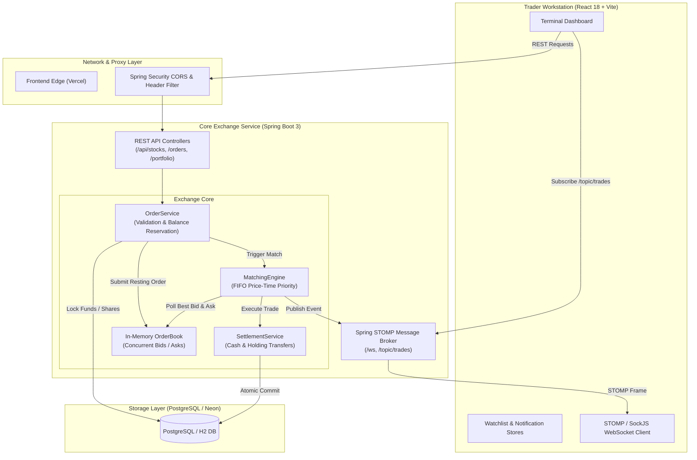

# Shadow Exchange

> **High-Performance Simulated Equities Exchange & Dark Terminal Trading Interface**  
> Built with Spring Boot 3, Java 21, React 18, TypeScript, and Neon PostgreSQL.

[]()
[]()
[]()
[]()
[]()
[]()

---

## 1. Project Overview & Honest Scope

**Shadow Exchange** is an institutional-grade simulated electronic equities exchange. It provides a real-time limit order book, price-time priority matching engine, balance reservation system, atomic trade settlement, and low-latency WebSocket STOMP market streaming—paired with a dark Bloomberg/terminal-inspired single-page web interface.

> [!NOTE]  
> **Simulation Notice:** Shadow Exchange is a simulated financial exchange and engineering demonstration. All listed instruments, order books, cash balances, and executions are virtual. No real capital, actual brokerages, or regulated clearinghouses are involved.

### Key Capabilities
- **Curated 28-Instrument Universe:** Liquid US equities across Tech, Finance, Healthcare, and Energy (including NVDA, AAPL, MSFT, TSLA, AMZN, GOOGL, META, JPM, etc.) with deterministic idempotent database seeding.
- **In-Memory FIFO Matching Engine:** Continuous price-time priority limit order matching with multi-stock isolation and resting-maker pricing.
- **Strict Reservation Ledger:** Pre-trade purchasing-power locking for BUY orders and share-locking for SELL orders prevents cash overdrafts and short-selling.
- **Atomic Trade Settlement:** Spring managed transaction boundaries ensure balances, holdings, and order statuses update consistently before database commit.
- **STOMP WebSocket Market Feed:** Real-time trade events broadcast over `/topic/trades` with a lean, strictly-typed 6-field DTO.
- **Terminal Trading UI:** High-density dark workstation with interactive Market Pulse benchmark sparklines, in-place global search & command palette, reactive watchlist, customizable signatures, and precision reticle cursors.
- **Zero-Friction Demo Mode:** Immediate sandboxed trading accounts with $100,000.00 virtual cash and per-account isolated favorites.

---

## 2. Architecture Diagram



---

## 3. Technology Stack

### Backend
- **Language / Runtime:** Java 21 (LTS)
- **Framework:** Spring Boot 3.4.3
- **Data Persistence:** Spring Data JPA / Hibernate 6
- **Database:** PostgreSQL (Production / Neon Cloud) or in-memory H2 (Local Development & Testing)
- **Real-Time Communication:** Spring WebSocket with STOMP message broker (`/topic/trades`)
- **Build & Dependency Tool:** Apache Maven Wrapper (`mvnw` / `mvnw.cmd`)
- **Testing:** JUnit 5, Mockito, Spring Boot Test, Spring Security Test (79 unit & integration tests)

### Frontend
- **Framework:** React 18.3.1
- **Language:** TypeScript 5.6
- **Build Tool:** Vite 6.4.4
- **Styling:** Vanilla CSS design system with custom CSS variables, zero Tailwind bloat, and responsive flex/grid layouts
- **Icons:** Lucide React
- **WebSocket Client:** `@stomp/stompjs`
- **Testing:** Node.js native test runner (`node:test`, 89 unit & regression tests)

---

## 4. Local Setup & Run Instructions

### Prerequisites
- **Java Development Kit (JDK):** Version 21 or higher installed and on `PATH`.
- **Node.js:** Version 18.0.0 or higher.
- **Git**

### 1. Clone Repository
```bash
git clone https://github.com/shivkumar077/Shadow-Exchange.git
cd Shadow-Exchange
```

### 2. Run Backend (Spring Boot)
The default configuration uses an embedded, zero-configuration H2 database with automatic schema generation and instrument universe seeding:
```bash
# On Linux / macOS
./mvnw spring-boot:run

# On Windows PowerShell / CMD
.\mvnw.cmd spring-boot:run
```
The backend initializes at `http://localhost:8080`.

### 3. Run Frontend (React Vite)
Open a second terminal window:
```bash
cd frontend
npm install
npm run dev
```
The terminal interface opens at `http://localhost:5173`.

---

## 5. Environment Variables & Configuration

### Backend (`application.properties` / Environment)

| Variable | Default Value | Description |
| :--- | :--- | :--- |
| `PORT` | `8080` | HTTP port for the Spring Boot server |
| `SPRING_DATASOURCE_URL` | `jdbc:h2:mem:shadow_exchange;...` | JDBC database connection string |
| `SPRING_DATASOURCE_USERNAME` | `sa` | Database username |
| `SPRING_DATASOURCE_PASSWORD` | *(empty)* | Database password |
| `CORS_ALLOWED_ORIGINS` | `http://localhost:5173` | Comma-delimited list of allowed frontend origins |
| `VITE_WS_URL` | *(empty / derived)* | Explicit STOMP WebSocket URL override |

### Frontend (`frontend/.env.local` or Vercel Environment)

| Variable | Default Value | Description |
| :--- | :--- | :--- |
| `VITE_API_BASE_URL` | `http://localhost:8080` | URL of the backend REST API |
| `VITE_WS_URL` | `ws://localhost:8080/ws` | STOMP WebSocket connection endpoint |

---

## 6. Database Configuration, Seeding & Lifecycle

### Schema Entities
1. **`stocks`**: Ticker symbol (unique), company name, current reference price.
2. **`users`**: Operator profile, email, password hash, `balance`, `reservedBalance`.
3. **`holdings`**: User portfolio positions (`quantity`, `reservedQuantity`, `stock_id`).
4. **`orders`**: Limit orders (`type`, `price`, `quantity`, `status`, `created_at`).
5. **`trades`**: Execution records (`buyer_id`, `seller_id`, `stock_id`, `price`, `quantity`, `executed_at`).

### Idempotent Instrument Seeding
On startup, `StockDataInitializer` seeds missing instruments into the database without duplicating records or resetting primary keys. The universe includes 28 liquid stocks:
- **Core 5:** NVDA, AAPL, MSFT, TSLA, AMZN
- **Tech & Communications:** GOOGL, META, AMD, AVGO, CSCO, INTC, NFLX
- **Financial Services:** JPM, BAC, GS, MS, V, MA
- **Industrial, Energy & Consumer:** CAT, BA, GE, XOM, CVX, WMT, COST, PG, JNJ, UNH

---

## 7. Order Book, Matching Engine & Settlement Design

### Price-Time Priority (FIFO)
1. Orders are stored per-stock in dual sorted collections:
   - **Bids (Buy):** Ordered by `price DESC`, then `createdAt ASC` (earliest maker priority).
   - **Asks (Sell):** Ordered by `price ASC`, then `createdAt ASC`.
2. Matching occurs when `bestBuy.price >= bestSell.price`.
3. Execution price is determined by the **resting order** (maker priority based on earlier `createdAt`).
4. Partial fills update remaining quantities and transition order status to `PARTIALLY_FILLED`. Once quantity reaches 0, the order transitions to `FILLED` and leaves the in-memory book.

### Pre-Trade Reservation & Settlement Flow

```mermaid
sequenceDiagram
    autonumber
    actor Trader as Trader (Web Terminal)
    participant API as OrderController
    participant Svc as OrderService
    participant Book as OrderBook
    participant Engine as MatchingEngine
    participant Settle as SettlementService
    participant WS as TradeWebSocketPublisher

    Trader->>API: POST /orders {userId, stockId, type: BUY, price: 150, qty: 10}
    API->>Svc: createOrder(orderRequestDTO)
    Svc->>Svc: Check available cash (balance - reservedBalance >= requiredFunds)
    Svc->>Svc: Lock funds: reservedBalance += requiredFunds
    Svc->>Book: addOrder(order)
    Svc->>Engine: match()
    
    rect rgb(20, 25, 30)
        Note over Engine,Settle: Execution Cycle
        Engine->>Book: getBestBuy(stock), getBestSell(stock)
        Engine->>Settle: settleTrade(trade)
        Settle->>Settle: Transfer funds (Buyer cash -> Seller cash)
        Settle->>Settle: Release Buyer reservedBalance
        Settle->>Settle: Transfer shares (Seller shares -> Buyer shares)
        Settle->>Settle: Release Seller reservedQuantity
    end

    Engine->>WS: publishEvent(TradeExecutedEvent)
    WS-->>Trader: STOMP /topic/trades (6-field DTO)
    API-->>Trader: HTTP 200 OrderResponseDTO
```


---

## 8. WebSocket STOMP Trade-Stream Details

- **Handshake Endpoint:** `/ws` (with SockJS fallback option)
- **Public Topic:** `/topic/trades`
- **Payload Contract:** Strictly contains **exactly 6 fields** for zero sensitive leakage:
```json
{
  "tradeId": 1042,
  "stockId": 1,
  "symbol": "NVDA",
  "price": 142.87,
  "quantity": 50,
  "executedAt": "2026-10-14T23:00:00"
}
```

### Throttled Frontend Refresh Coalescer
When high-frequency trades arrive over STOMP, the frontend uses an intelligent coalescer (`createTradeRefreshCoalescer` in `useTradeStream.ts`) to avoid flooding the backend with redundant portfolio re-fetch requests, batching refresh calls within a 750ms window.

---

## 9. API Reference & Testing Commands

### Public Market Endpoints
- `GET /api/stocks` — List all 28 supported instruments and reference prices.
- `GET /orders/book/{stockId}` — Inspect resting bids and asks for a given stock.
- `GET /actuator/health` — Service health probe.

### Account & Trading Endpoints
- `POST /api/users/demo` — Provision a new simulated demo account with $100,000.00 cash.
- `GET /api/users/{userId}` — Retrieve user profile and cash balance.
- `GET /api/users/{userId}/portfolio` — Retrieve holdings, reserved shares, and market values.
- `GET /orders/user/{userId}` — List user's active and historical orders.
- `POST /orders` — Submit a new limit order (`{ userId, stockId, type, price, quantity }`).
- `DELETE /orders/{orderId}` — Cancel an active resting order and release reserved funds/shares.

### Test Suites
```bash
# Run backend test suite (79 tests)
.\mvnw.cmd test

# Run frontend test suite (89 tests)
cd frontend
npm test

# Build frontend production bundle
npm run build
```

---

## 10. Authentication Roadmap & Google OAuth Milestone

For a detailed breakdown of the planned Google OAuth 2.0 integration, IDOR protection, session cookie lifecycles, and database migrations, refer to:
👉 [Google OAuth Milestone Specification](file:///c:/Users/sk699/OneDrive/Desktop/java/springboot/shadow-exchange/docs/GOOGLE_OAUTH_MILESTONE_SPEC.md)

---

## 11. Deployment Information & Known Limitations

### Current Live Deployment
- **Frontend:** Hosted on Vercel at `https://shadow-exchange-live.vercel.app/`
- **Backend:** Hosted on Render container infrastructure.

### Known Architectural Limitations
1. **In-Memory Order Book:** The resting order book currently resides in JVM heap memory. A container restart re-seeds default data; persistence of resting books across restarts is scheduled for the Redis/cluster milestone.
2. **Order Type Support:** Shadow Exchange currently supports **Limit Orders only**. Market orders, stop-loss, and trailing stops are intentionally not offered to ensure deterministic fills.
3. **Demo Security Model:** The current version is designed as an open sandbox where demo user accounts can be created friction-free. IDOR mitigation and token sessions will be finalized during the Google OAuth milestone.
